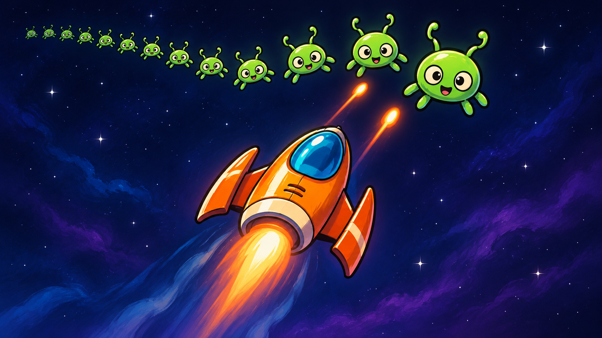
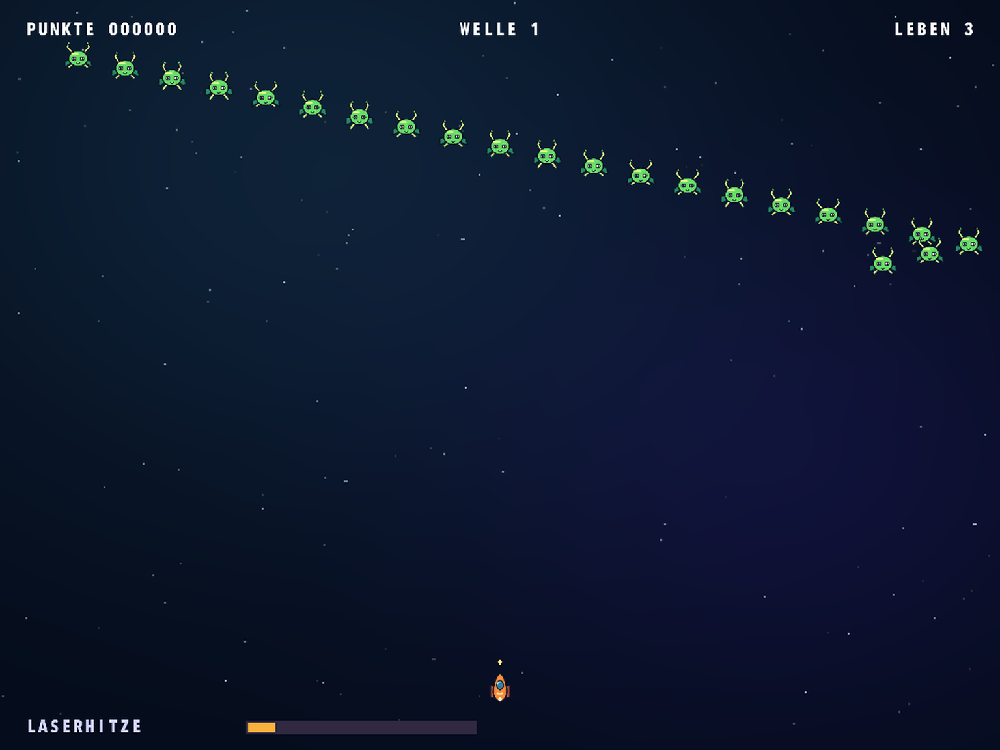
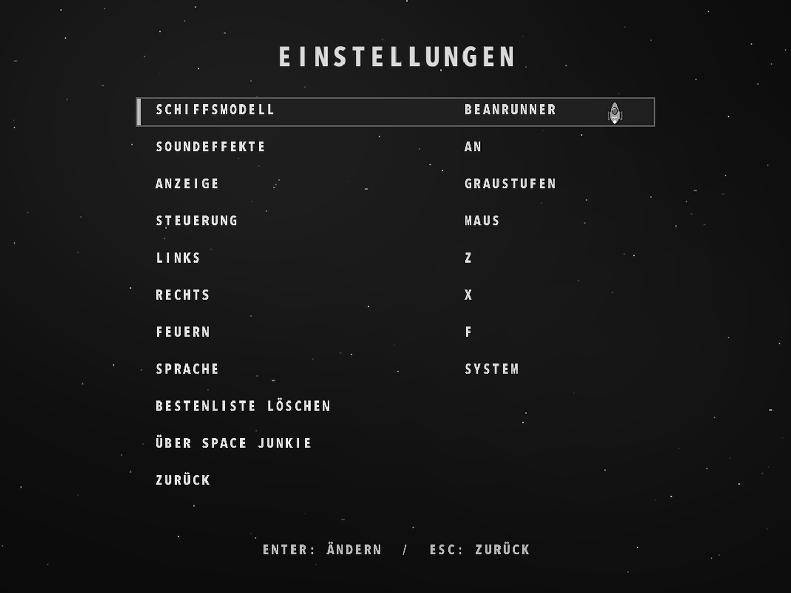

# Space Junkie

[English](README.md) · [Français](README.fr.md) · [Español](README.es.md) · [Deutsch](README.de.md) · [Português](README.pt.md) · [Italiano](README.it.md)

[Spielseite](https://rea.com.co/de/applications/space-junkie/) · [Downloads](https://github.com/rea-studio-repos/space-junkie/releases)

Steuere ein Raumschiff im Cartoonstil durch 14 Gegnerformationen in einem klassischen Arcade-Shooter. Weiche Schüssen aus, zerstöre gegnerische Geschosse und behalte die Temperatur deines Lasers im Blick: Überhitzt er, muss er erst abkühlen. Wähle eines von sechs Schiffen und jage deinen Highscore mit der Maus oder einer frei belegbaren Tastatursteuerung.

Spiele mit neu gestalteter Cartoon-Grafik. Das Spiel übernimmt standardmäßig die Systemsprache. In den Einstellungen kannst du sie ändern.

- 14 Gegnerformationen
- Sechs Schiffe und eine lokale Bestenliste
- Maussteuerung oder frei belegbare Tasten

## Screenshots

Space Junkie 1.3.0 · REA Studio
