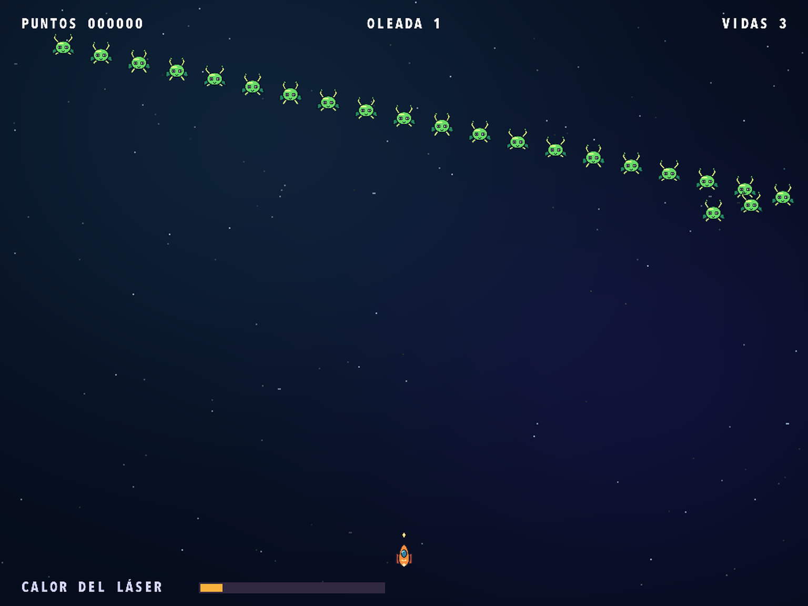
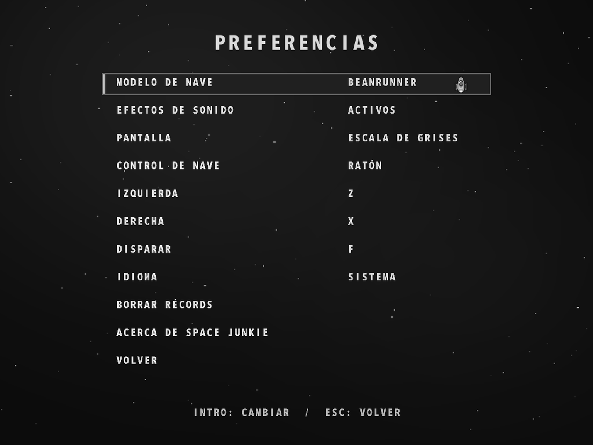

# Space Junkie

[English](README.md) · [Français](README.fr.md) · [Español](README.es.md) · [Deutsch](README.de.md) · [Português](README.pt.md) · [Italiano](README.it.md)

[Página del juego](https://rea.com.co/applications/space-junkie/) · [Descargas](https://github.com/rea-studio-repos/space-junkie/releases)

Pilota una nave de estilo cartoon en un clásico de disparos arcade y enfréntate a 14 formaciones enemigas. Esquiva los disparos, derriba proyectiles y vigila la temperatura del láser: si se sobrecalienta, tendrás que dejarlo enfriar. Elige entre seis naves y supera tu récord con el ratón o con controles de teclado personalizables.

Disfruta de los gráficos cartoon remasterizados. El juego usa el idioma del sistema de forma predeterminada, y puedes cambiarlo en Preferencias.

- 14 formaciones enemigas
- Seis naves y clasificación local
- Ratón o controles de teclado personalizables

## Capturas del juego

Space Junkie 1.3.0 · REA Studio
