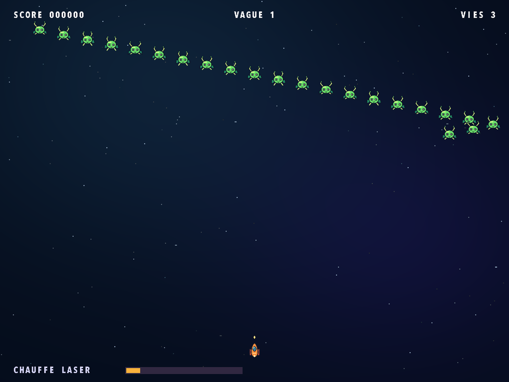
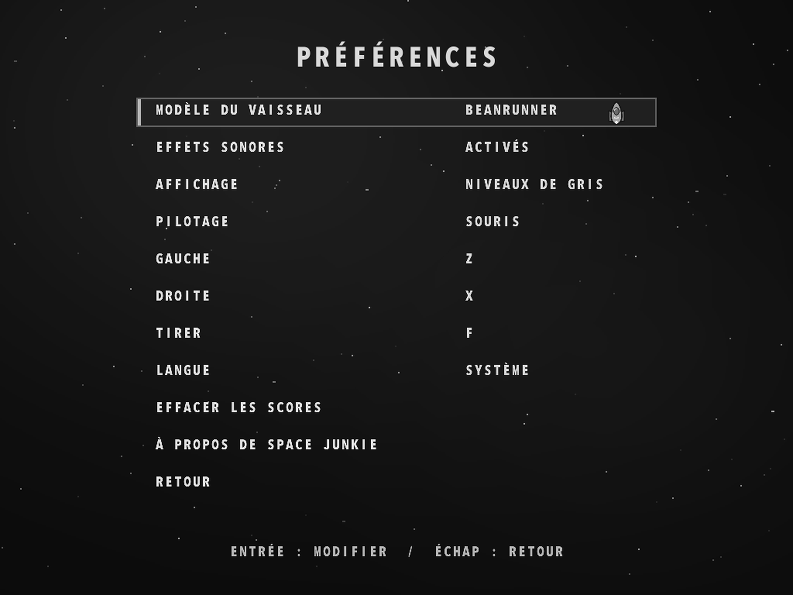

# Space Junkie

[English](README.md) · [Français](README.fr.md) · [Español](README.es.md) · [Deutsch](README.de.md) · [Português](README.pt.md) · [Italiano](README.it.md)

[Page du jeu](https://rea.com.co/fr/applications/space-junkie/) · [Téléchargements](https://github.com/rea-studio-repos/space-junkie/releases)

Pilotez un vaisseau cartoon dans un jeu de tir arcade et affrontez 14 formations ennemies. Esquivez les tirs, détruisez les projectiles adverses et surveillez la chauffe du laser : s’il surchauffe, il faut le laisser refroidir. Choisissez parmi six vaisseaux et battez votre meilleur score à la souris ou avec des touches personnalisables.

Retrouvez les graphismes cartoon remasterisés. Le jeu utilise la langue du système par défaut ; vous pouvez la changer dans les préférences.

- 14 formations ennemies
- Six vaisseaux et un classement local
- Souris ou touches personnalisables

## Captures du jeu

Space Junkie 1.3.0 · REA Studio
