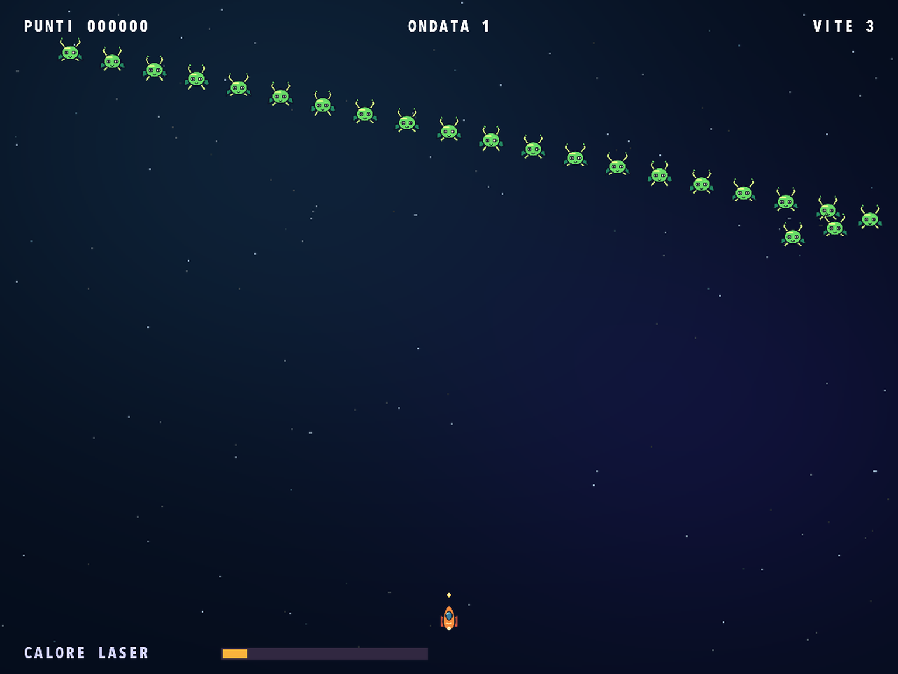
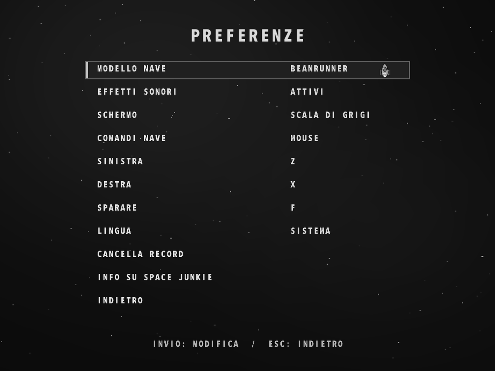

# Space Junkie

[English](README.md) · [Français](README.fr.md) · [Español](README.es.md) · [Deutsch](README.de.md) · [Português](README.pt.md) · [Italiano](README.it.md)

[Pagina del gioco](https://rea.com.co/en/applications/space-junkie/) · [Download](https://github.com/rea-studio-repos/space-junkie/releases)

Pilota una navicella in stile cartoon e affronta 14 formazioni nemiche in un classico sparatutto arcade. Schiva i colpi, distruggi i proiettili nemici e tieni d’occhio la temperatura del laser: se si surriscalda, dovrai lasciarlo raffreddare. Scegli una delle sei navicelle e supera il tuo record con il mouse o con comandi da tastiera personalizzabili.

Gioca con la grafica cartoon rimasterizzata. Per impostazione predefinita il gioco usa la lingua del sistema, che puoi cambiare nelle Preferenze.

- 14 formazioni nemiche
- Sei navicelle e classifica locale
- Mouse o comandi da tastiera personalizzabili

## Schermate di gioco

Space Junkie 1.3.0 · REA Studio
