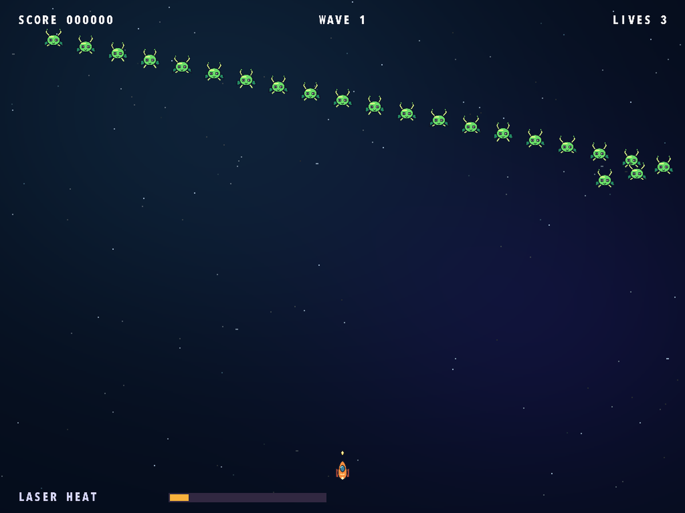
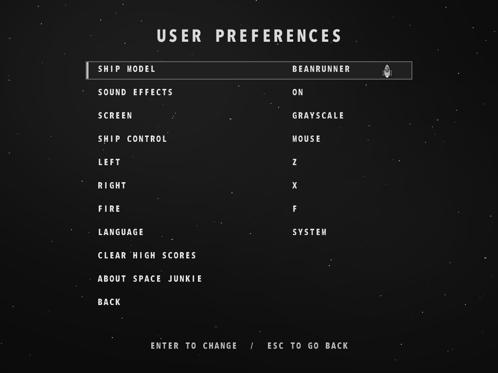

# Space Junkie

[English](README.md) · [Français](README.fr.md) · [Español](README.es.md) · [Deutsch](README.de.md) · [Português](README.pt.md) · [Italiano](README.it.md)

[Product website](https://rea.com.co/en/applications/space-junkie/) · [Downloads](https://github.com/rea-studio-repos/space-junkie/releases)

Pilot a cartoon starfighter through 14 enemy formations in a classic arcade shooter. Dodge incoming fire, shoot down enemy projectiles and watch your laser heat: if it overheats, you’ll need to let it cool. Pick one of six ships and chase your best score with mouse controls or a keyboard layout you can customize.

Play with remastered cartoon graphics. The game follows your system language by default, and you can change it in Preferences.

- 14 enemy formations
- Six ships and local high scores
- Mouse controls or customizable keyboard controls

## Screenshots

Space Junkie 1.3.0 · REA Studio
