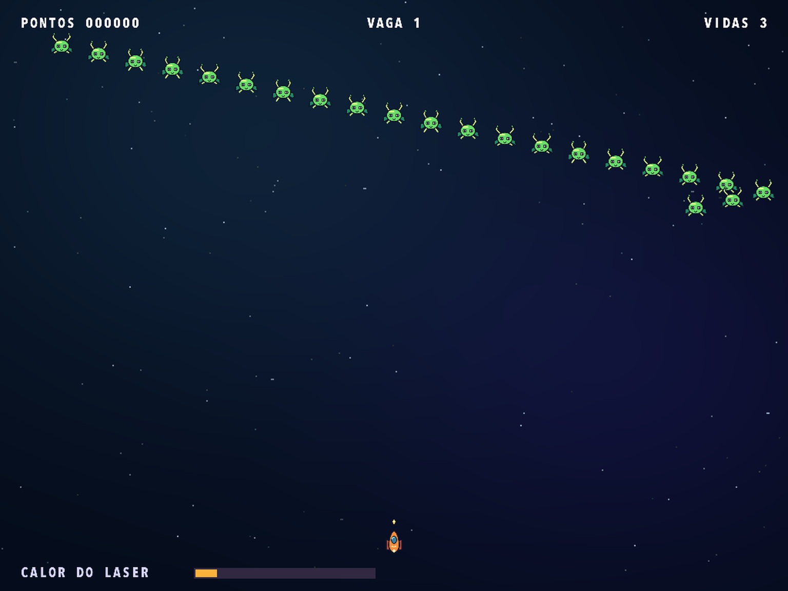
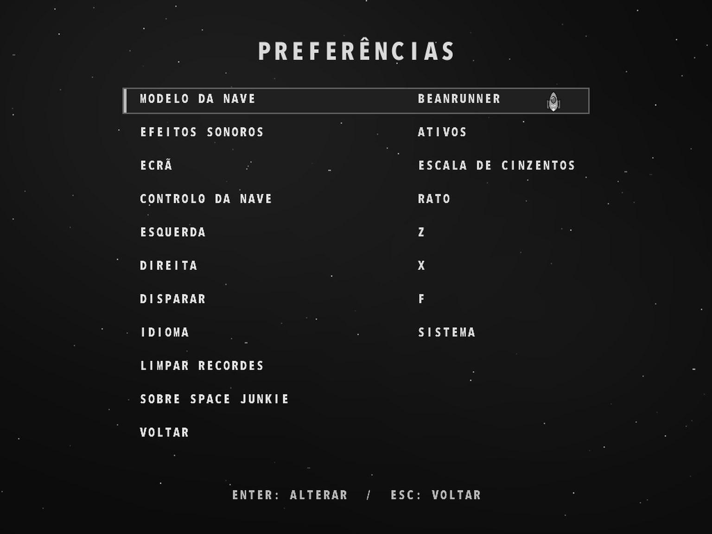

# Space Junkie

[English](README.md) · [Français](README.fr.md) · [Español](README.es.md) · [Deutsch](README.de.md) · [Português](README.pt.md) · [Italiano](README.it.md)

[Página do jogo](https://rea.com.co/en/applications/space-junkie/) · [Downloads](https://github.com/rea-studio-repos/space-junkie/releases)

Pilote uma nave em estilo cartoon e enfrente 14 formações inimigas em um jogo de tiro arcade clássico. Desvie dos disparos, destrua projéteis inimigos e fique de olho na temperatura do laser: se ele superaquecer, será preciso esperar que esfrie. Escolha uma das seis naves e bata seu recorde com o mouse ou com controles de teclado personalizáveis.

Jogue com gráficos cartoon remasterizados. Por padrão, o jogo usa o idioma do sistema, que pode ser alterado nas Preferências.

- 14 formações inimigas
- Seis naves e ranking local
- Mouse ou controles de teclado personalizáveis

## Capturas do jogo

Space Junkie 1.3.0 · REA Studio
